# Blue Velvet - Documento de arquitectura y diseño del front

**Bitácora Corte 2 - DOSW 1**  
**Escuela Colombiana de Ingeniería**  
**Realizado por:** Juan Nicolás Álvarez Muñoz

---

## Índice

1. [Nombre del proyecto](#nombre-del-proyecto)
2. [Introducción de la solución](#introducción-de-la-solución)
3. [Pantallas y acceso por rol](#pantallas-y-acceso-por-rol)
4. [Flujo de navegación entre pantallas](#flujo-de-navegación-entre-pantallas)
5. [Tecnologías utilizadas](#tecnologías-utilizadas)
6. [Paleta de colores](#paleta-de-colores)
7. [Modelos de referencia](#modelos-de-referencia)
8. [Funcionalidades del sistema](#funcionalidades-del-sistema)
9. [Link de despliegue del front](#link-de-despliegue-del-front)
10. [Referencias bibliográficas](#referencias-bibliográficas)
11. [Historial de revisión](#historial-de-revisión)

---

## Nombre del proyecto

**Blue Velvet**, sitio web de una coctelería de autor en Bogotá.

---

## Introducción de la solución

El sitio es la cara de Blue Velvet frente a sus clientes y la herramienta de trabajo del personal. Un visitante conoce la casa, revisa la carta y reserva una mesa; un cliente con cuenta pide desde su mesa, sigue la preparación de su comanda y califica lo que probó; el mesero toma comandas y maneja la agenda de reservas; el bartender trabaja con el tablero de la barra y el inventario; y el administrador mantiene la carta y revisa el historial.

Toda la información viene de la API REST del mismo repositorio. El sitio no guarda datos propios: los archivos de `src/data` solo tienen el contenido editorial de cada producto (foto, historia, ingredientes y maridaje), que se une con los datos de la API por el nombre del producto.

La estética toma como referencia la película Blue Velvet de David Lynch (telón de terciopelo azul, luz de escenario y rojo carmín) junto con un estilo dark academia: madera oscura, latón, tipografía serif y una paleta oscura y melancólica.

---

## Pantallas y acceso por rol

| Pantalla | Ruta | Visitante | Cliente | Mesero | Bartender | Administrador |
|---|---|---|---|---|---|---|
| Inicio (landing) | `/` | Sí | Sí | Sí | Sí | Sí |
| La carta y ficha de producto | `/carta` | Sí | Sí, y puede pedir y calificar | Sí, y puede pedir | Sí | Sí |
| Ingreso y registro | `/acceso` | Sí | Sí | Sí | Sí | Sí |
| Mi cuenta | `/mi-cuenta` | No | Sí | No | No | No |
| Servicio | `/servicio` | No | No | Sí | No | No |
| La barra | `/barra` | No | No | No | Sí | No |
| Administración | `/administracion` | No | No | No | No | Sí |

Si alguien intenta abrir una pantalla sin haber iniciado sesión, el sitio lo lleva al ingreso y, al entrar, lo devuelve a la pantalla que había pedido. Si su rol no tiene acceso, lo lleva a su propio espacio.

| Pantalla | Descripción |
|---|---|
| Inicio | Cortina de terciopelo, galería del bar, principios de la casa, cócteles exclusivos, horario, formulario de reserva y ubicación. |
| La carta | Cócteles y cocina en pestañas, filtros por categoría y buscador. Cada producto abre una ficha con foto, historia, ficha técnica, adiciones, receta de referencia y calificaciones. |
| Ingreso y registro | Inicio de sesión para todos los roles y creación de cuenta para clientes. |
| Mi cuenta | Comanda en curso, comandas enviadas con su estado y reservas del cliente. |
| Servicio | Comanda en curso del mesero, comandas del salón con filtro por estado y agenda de reservas. |
| La barra | Tablero de comandas por estado e inventario de cócteles y modificadores. |
| Administración | Cócteles, cocina, modificadores, comandas, agenda e historial de eventos. |

### Capturas

**Inicio**

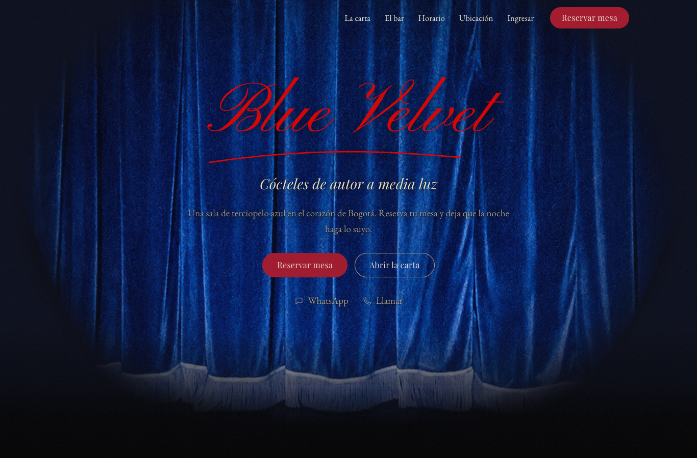

**La carta**

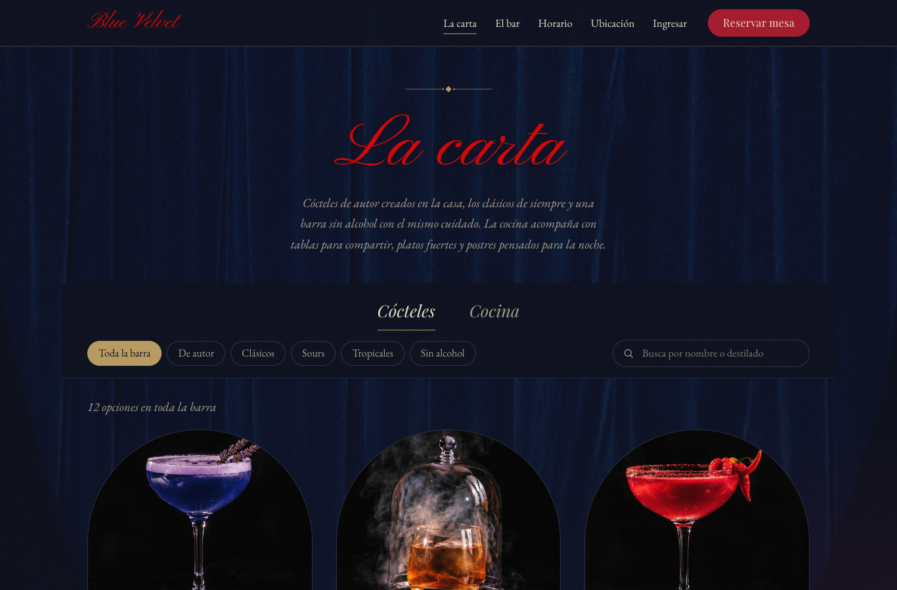

**Ficha de un cóctel con adiciones, pedido y receta de referencia**

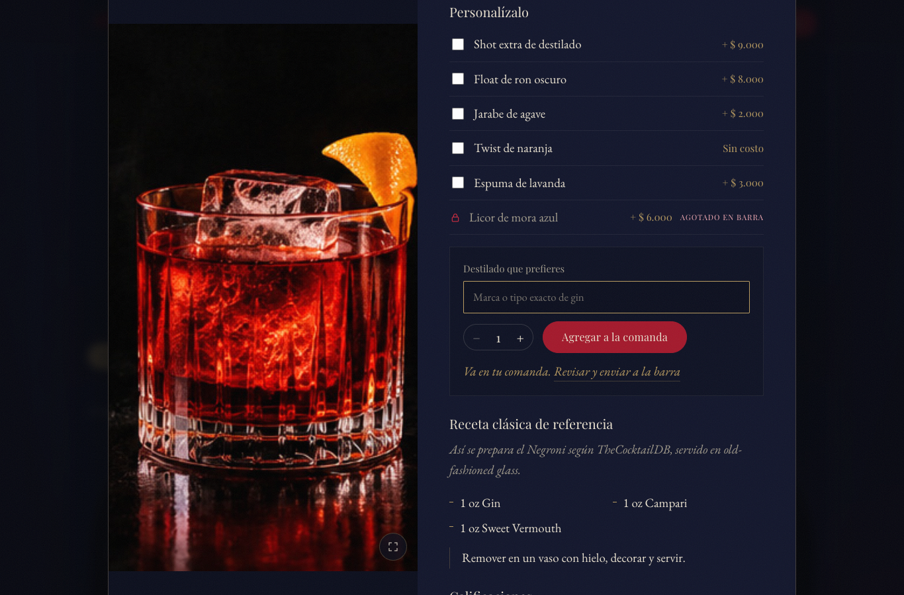

**Mi cuenta (cliente)**

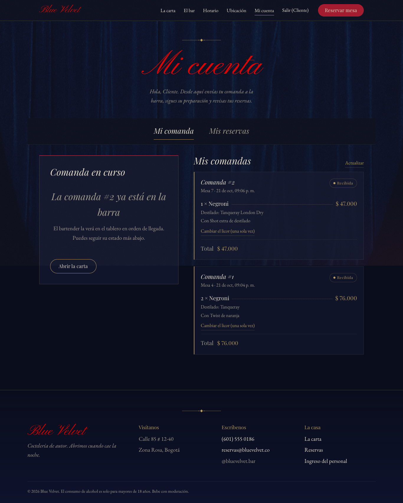

**Servicio (mesero)**

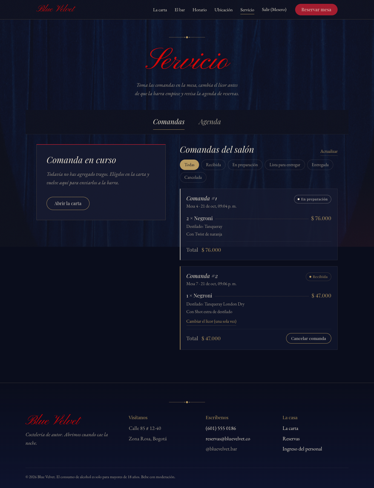

**Agenda de reservas**

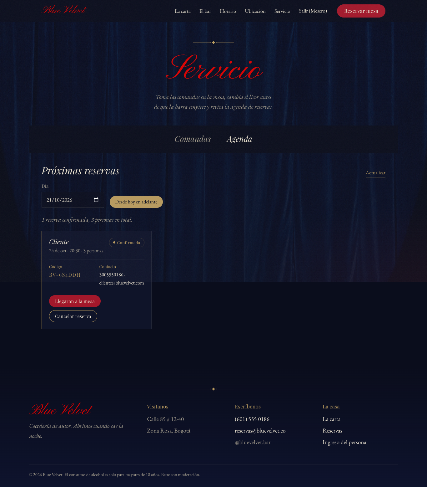

**Tablero de la barra (bartender)**

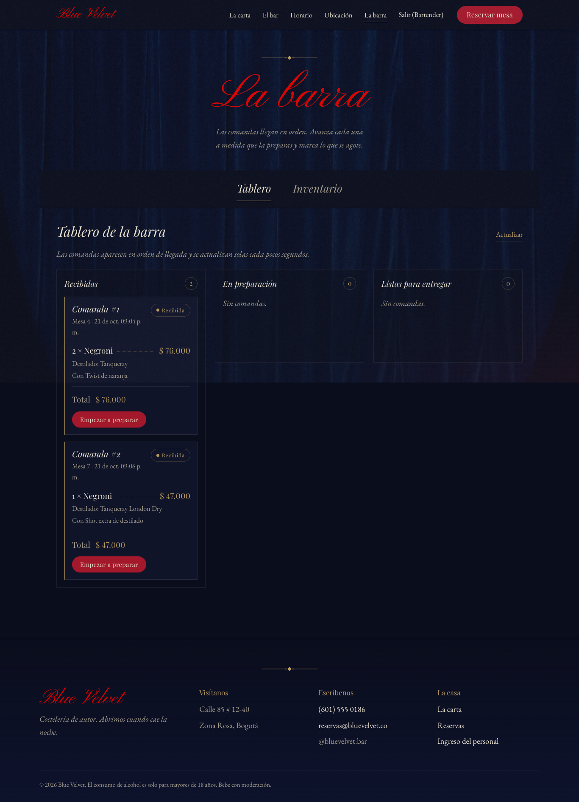

**Inventario de la barra**

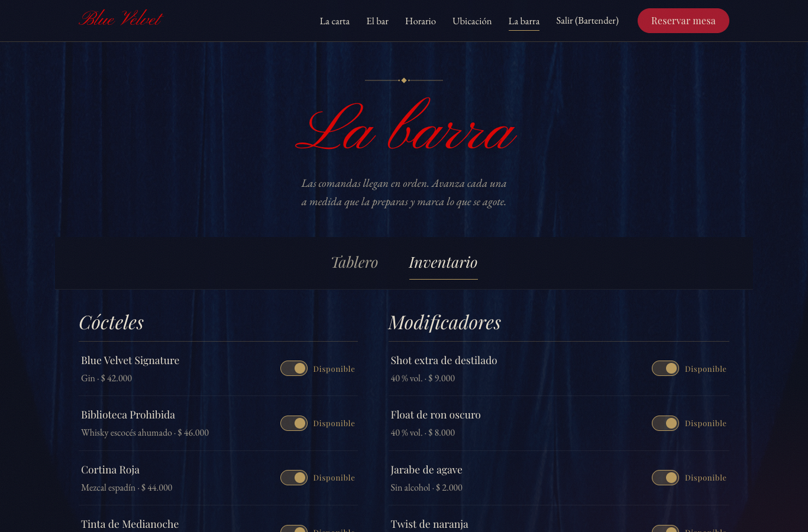

**Administración de la cocina**

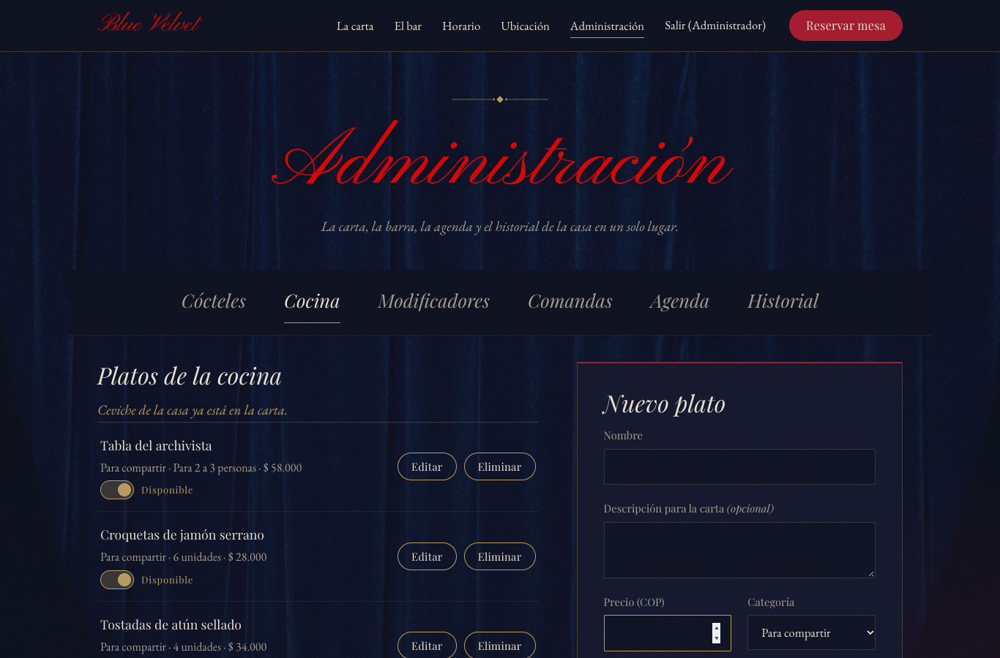

**Historial de eventos**

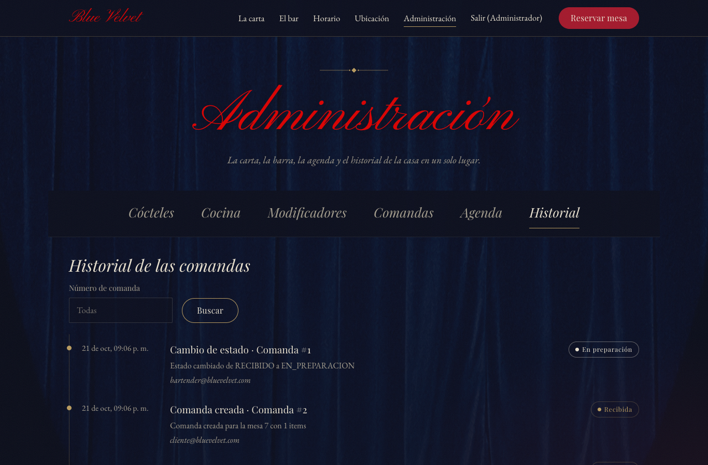

**Vista en celular**

| Ficha de un cóctel | Administración |
|---|---|
| 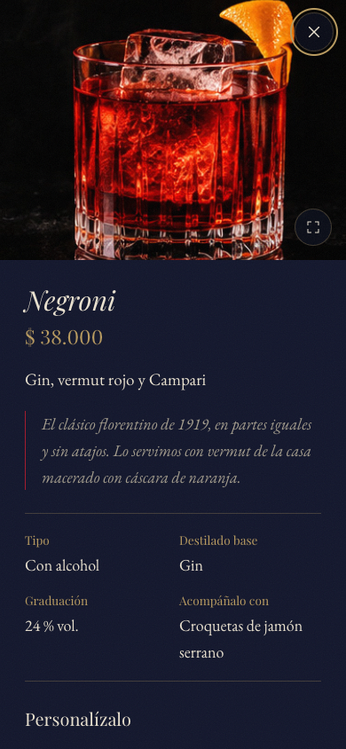 | 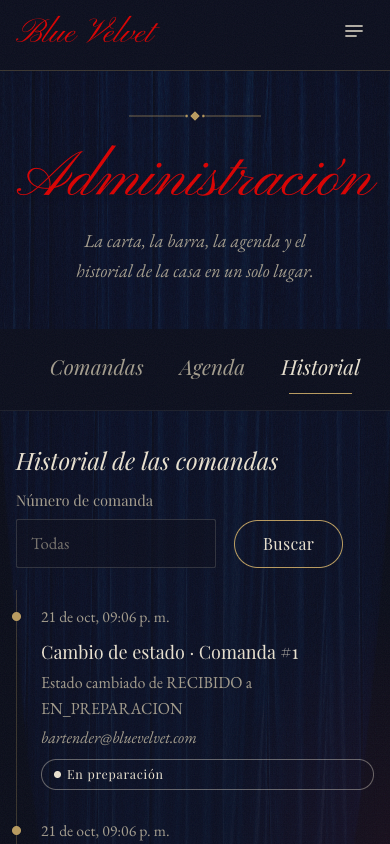 |

---

## Flujo de navegación entre pantallas

### Web

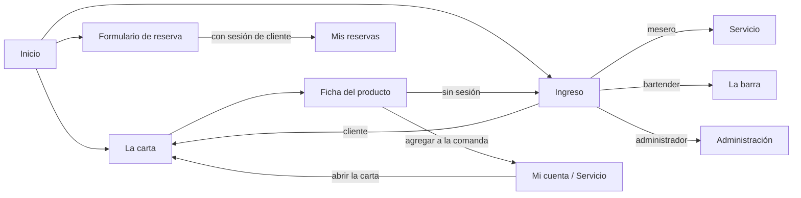

### Celular

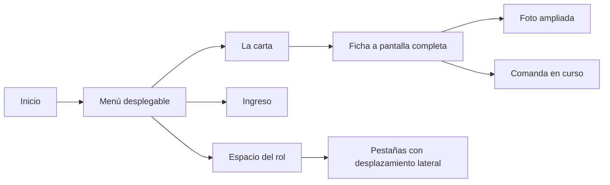

| Flujo | Explicación |
|---|---|
| Conocer y reservar | El visitante entra al inicio, recorre la galería y el horario y reserva desde el formulario. Al confirmar recibe un código. |
| Explorar la carta | Desde el inicio o el menú se abre la carta; cada producto abre su ficha en una ventana sobre la carta, con su propia dirección (`/carta?item=negroni`) para poder compartirla. |
| Ingresar | Desde el menú o desde la ficha de un producto se llega al ingreso. Después de entrar, el cliente vuelve a la carta (o a la pantalla que había pedido) y el personal va a su espacio de trabajo. |
| Pedir | El cliente o el mesero agrega cócteles desde la ficha, revisa la comanda en su espacio, escribe la mesa y la envía a la barra. |
| Atender | El bartender ve las comandas en el tablero y las avanza hasta entregarlas. El cliente ve el cambio de estado en Mi cuenta. |
| Administrar | El administrador cambia de sección con las pestañas: cócteles, cocina, modificadores, comandas, agenda e historial. |

En celular el menú principal se abre con un botón, la ficha de cada producto ocupa toda la pantalla, las pestañas de los espacios de trabajo se desplazan de lado y los paneles de dos columnas pasan a una sola.

---

## Tecnologías utilizadas

| Tecnología | Uso |
|---|---|
| React 18 | Construcción de la interfaz con componentes y hooks |
| Vite 5 | Entorno de desarrollo y compilación |
| React Router 6 | Navegación entre pantallas sin recargar la página |
| Axios | Comunicación con la API REST |
| CSS propio | Estilos por capas: `global.css`, `landing.css`, `carta.css` y `paneles.css` |
| Google Fonts | Playfair Display, EB Garamond y Pinyon Script |
| Vercel | Despliegue del sitio |

### Organización del proyecto

El código se agrupa por tipo de archivo y por funcionalidad:

```
frontend/
  public/img/          fotos del bar, los cócteles y la cocina
  src/
    api/               cliente Axios con la URL base, el token y los mensajes de error
    services/          llamadas a la API por recurso (carta, pedidos, reservas, inventario, autenticación)
    context/           sesión del usuario, comanda en curso y roles
    hooks/             useCarta, useConsulta, useBloquearScroll y useTeclaEscape
    data/              contenido editorial de los productos, horario y contacto
    components/
      layout/          cabecera y pie de página
      routing/         ruta protegida por rol
      ui/              componentes reutilizables (modal, estrellas, pestañas, estado, disponibilidad...)
    features/
      landing/         secciones del inicio
      carta/           carta, ficha, pedido, receta y calificaciones
      auth/            ingreso y registro
      comandas/        comanda en curso, lista de comandas y tablero de la barra
      reservas/        agenda y reservas del cliente
      inventario/      disponibilidad de cócteles y modificadores
      admin/           administración de la carta e historial
      paneles/         espacio de cada rol
    pages/             inicio y página no encontrada
    styles/            hojas de estilo
```

La sesión y la comanda en curso se comparten con `useContext`, la comanda se maneja con `useReducer` y las consultas a la API se hacen con el hook propio `useConsulta`, que maneja la carga, los errores y la actualización periódica del tablero y de las comandas.

### Variables de entorno

| Variable | Descripción |
|---|---|
| `VITE_API_URL` | URL base de la API. En desarrollo es `http://localhost:8080/api/v1` y en producción la del App Service de Azure (`.env.production`). |

---

## Paleta de colores

| Color | Código | Uso |
|---|---|---|
| Noche | `#0a0d1c` | Fondo general |
| Tinta | `#11152b` | Paneles, ventanas y tarjetas |
| Terciopelo | `#18245e` | Degradados y fondos de la cortina |
| Carmín | `#a3182b` | Botones principales y bordes destacados |
| Rojo | `#d90000` | Marca y títulos en letra de firma |
| Latón | `#b89a5e` | Precios, ornamentos, enlaces y estados |
| Marfil | `#e9e1cf` | Texto principal |
| Niebla | `#a39c8c` | Texto secundario |

Los productos agotados muestran el texto "AGOTADO EN BARRA" (o "AGOTADO EN COCINA") con un ícono de candado, de modo que la información no depende solo del color. Los estados de las comandas y reservas también llevan su nombre escrito.

---

## Modelos de referencia

- La película *Blue Velvet* (1986) de David Lynch: el telón azul, el escenario y el contraste con el rojo.
- El estilo *dark academia*: bibliotecas antiguas, madera oscura, latón y tipografía clásica.
- Las cartas impresas de bares de coctelería: nombre, línea de puntos y precio en cada producto.
- Los tableros de cocina (KDS) de los restaurantes para el tablero de la barra, con columnas por estado.

---

## Funcionalidades del sistema

### Consultar la carta

- **Descripción:** muestra los cócteles y los platos con su precio, disponibilidad y calificación.
- **Pantallas:** La carta y ficha del producto.
- **Flujo básico:** el usuario abre la carta, elige la pestaña de cócteles o de cocina, filtra por categoría o busca por nombre, destilado o ingrediente, y abre la ficha de un producto.
- **Flujo de errores:** si la API no responde se muestra un aviso en lugar de la lista. Si la búsqueda no encuentra nada se ofrece volver a ver toda la carta.

### Personalizar y pedir un cóctel

- **Descripción:** el cliente o el mesero agrega un cóctel a la comanda con su destilado, sus adiciones y la cantidad.
- **Pantallas:** ficha del cóctel, Mi cuenta y Servicio.
- **Flujo básico:** en la ficha se eligen las adiciones habilitadas, se escribe el destilado y la cantidad y se agrega a la comanda. En su espacio, el usuario revisa la comanda, escribe la mesa y la envía a la barra.
- **Flujo de errores:** si el cóctel lleva alcohol y no se escribe el destilado, la ficha lo pide antes de agregarlo. Las adiciones con alcohol aparecen bloqueadas en los mocktails y las agotadas aparecen con candado. Si la mesa no es válida o la API rechaza la comanda (por ejemplo, porque un producto se agotó), se muestra el mensaje y la comanda no se pierde.

### Seguir y modificar comandas

- **Descripción:** el cliente ve sus comandas y el mesero las del salón; ambos pueden cambiar el licor una sola vez mientras la comanda está recibida, y el mesero puede cancelarla.
- **Pantallas:** Mi cuenta y Servicio.
- **Flujo básico:** la lista se actualiza sola cada treinta segundos. En un ítem se elige "Cambiar el licor", se escribe el nuevo destilado y se guarda.
- **Flujo de errores:** el botón de cambio solo aparece cuando la regla lo permite; si la barra empezó a preparar la comanda entretanto, se muestra el mensaje de la API.

### Tablero de la barra

- **Descripción:** el bartender ve las comandas activas en tres columnas (recibidas, en preparación y listas) y las avanza.
- **Pantallas:** La barra (y Administración, solo para consultar).
- **Flujo básico:** el tablero se actualiza cada quince segundos; el bartender pulsa "Empezar a preparar", "Marcar como lista" y "Entregada en la mesa".
- **Flujo de errores:** si la API rechaza el cambio de estado, el mensaje aparece en la tarjeta de la comanda.

### Inventario y administración de la carta

- **Descripción:** el bartender y el administrador marcan cócteles y modificadores como agotados; el administrador crea, edita y elimina cócteles y platos y crea modificadores.
- **Pantallas:** La barra (inventario) y Administración.
- **Flujo básico:** el interruptor de cada producto cambia su disponibilidad al instante. El formulario de la derecha crea o edita el producto elegido.
- **Flujo de errores:** el formulario valida los campos antes de enviar (por ejemplo, el destilado de un cóctel con alcohol). Si el nombre ya existe o el cóctel tiene comandas y no se puede eliminar, se muestra el mensaje de la API.

### Reservar una mesa

- **Descripción:** cualquier persona reserva una mesa y recibe un código. Si tiene sesión de cliente, la reserva aparece en Mis reservas.
- **Pantallas:** Inicio (formulario de reserva) y Mi cuenta.
- **Flujo básico:** se llenan nombre, teléfono, correo, fecha, hora y personas, y se confirma la reserva.
- **Flujo de errores:** el formulario avisa si la fecha ya pasó, si es lunes, si las personas no están entre 1 y 12 o si el teléfono o el correo no son válidos. Las mismas reglas se validan otra vez en la API.

### Agenda de reservas

- **Descripción:** el mesero y el administrador consultan las reservas del día o las próximas y las marcan como cumplidas o canceladas. El cliente puede cancelar las suyas.
- **Pantallas:** Servicio, Administración y Mi cuenta.
- **Flujo básico:** se elige el día, se revisa el número de reservas y personas, y al llegar los clientes se marca "Llegaron a la mesa".
- **Flujo de errores:** cancelar pide confirmación; si la reserva ya no está confirmada, se muestra el mensaje de la API.

### Calificar productos

- **Descripción:** los clientes califican de una a cinco estrellas y dejan un comentario. Todos pueden ver el promedio y las opiniones.
- **Pantallas:** ficha del producto.
- **Flujo básico:** el cliente elige las estrellas, escribe un comentario opcional y lo publica con el nombre de su cuenta.
- **Flujo de errores:** sin sesión se invita a ingresar. Si el cliente ya había calificado el producto, se muestra el aviso.

### Receta de referencia

- **Descripción:** para los cócteles clásicos se muestra cómo se preparan según TheCocktailDB (ingredientes, vaso y preparación).
- **Pantallas:** ficha del cóctel.
- **Flujo básico:** al abrir la ficha, el sitio pide la receta a la API, que la consulta en el servicio externo.
- **Flujo de errores:** si el cóctel es de autor y no tiene receta externa, o si el servicio externo no responde, la sección no se muestra y el resto de la ficha funciona igual.

### Ingreso y registro

- **Descripción:** todos los roles ingresan con correo y contraseña; los clientes nuevos crean su cuenta.
- **Pantallas:** Ingreso y registro.
- **Flujo básico:** después de ingresar, el sitio consulta el perfil y lleva a cada rol a su espacio. El token se envía en cada petición.
- **Flujo de errores:** credenciales incorrectas, correo repetido, contraseña débil o cuenta bloqueada por intentos fallidos muestran su mensaje. Si el token vence, la sesión se cierra y se pide ingresar de nuevo.

---

## Link de despliegue del front

https://blue-velvet-jnam.vercel.app

El proyecto en Vercel usa la carpeta `frontend` como raíz, `npm run build` como comando de compilación y `dist` como carpeta de salida. El archivo `vercel.json` redirige todas las rutas a `index.html` para que la navegación funcione al recargar cualquier pantalla.

---

## Referencias bibliográficas

- React. *Documentación de React*. https://react.dev/
- React Router. *Documentación*. https://reactrouter.com/
- Axios. *Documentación*. https://axios-http.com/docs/intro
- Vite. *Guía*. https://vite.dev/guide/
- Vercel. *Documentación*. https://vercel.com/docs
- MDN Web Docs. *Diseño adaptable*. https://developer.mozilla.org/es/docs/Learn/CSS/CSS_layout/Responsive_Design
- W3C. *Pautas de Accesibilidad para el Contenido Web (WCAG) 2.1*. https://www.w3.org/TR/WCAG21/
- Material de clase DOSW 1, semana 11. Escuela Colombiana de Ingeniería Julio Garavito.

---

## Historial de revisión

| Versión | Fecha | Descripción |
|---|---|---|
| 1.0 | 2026-10-21 | Prototipo funcional con la landing, la carta y el ingreso, usando datos locales. |
| 1.1 | 2026-10-21 | Conexión con la API: sesión por rol, pedidos, tablero de la barra, inventario, administración de la carta, reservas, calificaciones y receta de referencia. |
